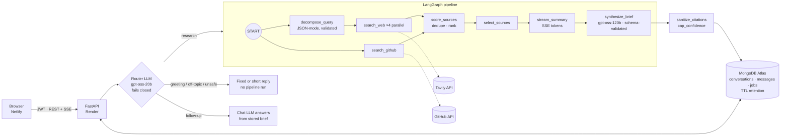

<div align="center">

# 🧠 ResearchMind AI

### A LangGraph research agent that turns a technology question into a cited, comparison-based R&D brief

[](https://github.com/patelyogi2635-gif/ResearchMind-AI/actions/workflows/ci.yml)
[](https://researchmind-ai.netlify.app)


**[Live demo](https://researchmind-ai.netlify.app)** · **[Results](#-results-at-a-glance)** · **[Architecture](#️-architecture)** · **[Evaluation](#-evaluation)** · **[Run locally](#-run-locally)** · **[API](#-api-reference)** · **[Limitations](#️-known-limitations)**

</div>

---

## Summary

Engineers often need to answer questions like *"Which vector database should we use for 1M documents with hybrid search?"* Answering them well means searching several sources, comparing options against criteria, and being honest about how strong the evidence is.

ResearchMind AI automates a first pass of that work. Given a technology question it:

1. decomposes the question into sub-questions,
2. searches the web (Tavily) and GitHub in parallel,
3. ranks and de-duplicates the sources,
4. writes a **structured brief** with options, a comparison matrix, risks, a recommendation with a confidence level, and a proof-of-concept plan, citing sources by number.

It is a portfolio project. Besides the agent itself, I wanted to practise the engineering around an LLM application: an **offline evaluation harness**, streaming over SSE, retries and rate-limit handling, a background job system, authentication, and tests. The [Known limitations](#️-known-limitations) section is deliberately explicit about what is not solved.

---

## 📈 Results at a glance

Measured with the project's own eval harness on **24 hand-written topics, one run each** (2026-11-19). Read these together with [How to read these numbers](#how-to-read-these-numbers): they are a regression signal for this system, not an independent benchmark.

| Metric | Result | Meaning |
|---|---:|---|
| Successful runs | 24 / 24 | A schema-valid brief was returned |
| Structure checks | 100 % | ≥2 options, ≥2 comparison rows, recommendation, summary, PoC plan present |
| Topic coverage | 100 % | Brief names at least one expected candidate (keyword check) |
| Citation coverage | 94.9 % | Options/comparison rows carrying at least one **valid source number** |
| Groundedness (LLM judge) | 77.7 % | Share of sampled claims a judge model rated supported (partial = 0.5) |
| Latency p50 / p95 | 13.4 s / 21.9 s | End-to-end, measured from the eval runner (max 40.1 s) |
| Tokens per brief | ≈ 6.4 k | ≈ 2.6 k input + 3.8 k output |

Citation coverage and groundedness measure different things: the first only checks that a citation number exists, the second asks whether the claim is actually supported by the sources. The gap between 94.9 % and 77.7 % is exactly why both are tracked.

---

## 🎬 Example run

Timings are the per-node means from the 24-topic eval, shown for the `agent-frameworks` topic ("Compare LangGraph, CrewAI and AutoGen for production multi-agent systems"):

```
router            → intent = research
decompose_query   → 4 focused sub-questions
search_web  ┐     → parallel retrieval, dedupe and rank   (GitHub search starts alongside the planner)
search_github ┘
stream_summary    → executive summary streamed to the UI
synthesize_brief  → schema-validated brief (JSON → markdown)
                    total 13.7 s · 4 sources · recommendation LangGraph · judge groundedness 0.98
```

**Brief schema (`RDBrief`, Pydantic):** title, problem statement, executive summary, landscape, 2–4 options (maturity, strengths, weaknesses, `source_ids`), comparison matrix, risks (severity and mitigation), recommendation (choice, rationale, confidence, next steps), PoC plan, limitations.

---

## 🏛️ Architecture



### Request lifecycle

1. `POST /api/research/jobs` returns **202** with a `job_id` and stream URL; the request does not block on the LLM.
2. A small **router model** classifies the message (`greeting`, `research`, `follow_up`, `off_topic`, `unsafe`, `unclear`) using recent conversation context, and rewrites follow-ups into a self-contained research query.
3. Research messages run the **LangGraph pipeline** under a global concurrency limit. Each node is wrapped to emit `node_started` / `node_completed` events with timings.
4. The client reads **Server-Sent Events**. A live job can be re-attached with `Last-Event-ID` to replay events it missed; jobs can be cancelled with `DELETE`.
5. The outcome is saved to MongoDB (when available). See [Restart behaviour](#restart-behaviour-what-recovery-does-and-does-not-do).

### How the pipeline works

| Node | What it does |
|---|---|
| `decompose_query` | Asks the model (JSON mode, validated with Pydantic) for 4 searchable sub-questions. Retries once; falls back to the raw query if no plan is produced. |
| `search_web` | One Tavily query per sub-question, run concurrently. Results below a relevance score of 0.2 are dropped. A failed sub-question does not fail the node. |
| `search_github` | One repository search per topic with keyword extraction and a minimum-stars filter. Adds stars, licence and last-push date to the snippet as maturity signals. |
| `score_sources` | De-duplicates by URL, ranks by relevance score, keeps the top 6. Raises an error if nothing usable was found. |
| `select_sources` | Chooses the sources passed to the writer (up to 4 web + 2 GitHub). |
| `stream_summary` | Streams a short executive summary so the UI shows text before the full brief exists. |
| `synthesize_brief` | Generates the full JSON brief against the `RDBrief` schema (bounded retries, rate-limit waits), then applies the two deterministic checks below. |

### Deterministic post-checks on the brief

These are plain code, covered by unit tests, and run after the model responds:

- **`sanitize_citations`** removes source numbers that do not correspond to a real retrieved source. This prevents *dangling or invented citation IDs*. It does **not** verify that a cited source actually supports the claim: a real source number can still be attached to an unsupported statement. Claim-level support is what the offline groundedness judge estimates (77.7 % in the latest run).
- **`cap_confidence`** lowers the stated confidence when the recommended option is backed by fewer than 2 independent source domains (→ medium) or by none (→ low), and records this in `limitations`. It is a heuristic about source diversity, not a measure of correctness.

### Key design decisions

| Decision | Reasoning | Trade-off |
|---|---|---|
| Direct Tavily/GitHub REST calls instead of MCP at runtime | The first version used MCP stdio servers launched through `npx`. Direct async HTTP with a shared connection pool is simpler to time-box and retry, and retrieval time dropped sharply in my measurements (see [Performance](#-performance-and-what-changed)). | Gave up the "swap any MCP server" flexibility. Retrieval is isolated in `core/search_api.py`. |
| JSON mode + Pydantic validation instead of tool calling for planner/writer | Tool calling intermittently failed (the model answered in prose), which silently reduced research to one search. JSON mode with validation and bounded retries behaved more predictably. | Needs tolerant validators (string-vs-list coercion, enum casing). |
| Router that **fails closed** | If no valid classification is obtained, the request is rejected rather than run unchecked. | Provider outages surface as 429/503 errors instead of degraded answers. |
| Post-checks in code rather than prompt rules alone | The model cannot be relied on to follow citation and confidence rules, so basic invariants are enforced and unit-tested. | Extra code; limited to the invariants that can be checked mechanically. |
| Smaller model for routing/chat/summary/judge, larger for the brief | Quality matters most for the brief; the other calls are short. | Not ablated: I did not measure quality or cost without this split. |
| One active job per conversation | Avoids interleaved writes and duplicate pipelines. | Users wait for the current answer before sending another message. |

---

## 🛡️ Reliability

| Area | What is implemented |
|---|---|
| Retries | `tenacity` exponential back-off with jitter for HTTP 429/5xx and transport errors only (not 4xx). |
| LLM rate limits | The provider's `Retry-After` header or "try again in Xs" hint is parsed and waited out (capped at 6 s), then retried a bounded number of times. |
| Timeouts | HTTP 20 s (5 s connect), router 15 s, chat 45 s, writer LLM 90 s, whole pipeline 180 s. |
| Concurrency limits | Process-wide semaphores: 3 pipelines, 8 searches, 4 LLM calls. New jobs get `429 server_busy` when 20 are already queued or running. |
| Graceful degradation | A failed sub-question search, a failed summary stream, or a failed plan does not abort the run (fallbacks are unit-tested). |
| Streaming | Streamed chunks are coalesced; retries are not attempted after tokens were already shown; the streamed summary is reused verbatim in the final brief so the UI text does not change. |
| Error shape | Uniform error envelope with a `request_id`; unexpected exceptions return a generic message (tested). |
| Observability | `X-Request-ID` on every response, structured key=value logs per request and per node, `/api/health` (liveness) and `/api/health/ready` (queue and job counts, MongoDB state). |

### Restart behaviour: what recovery does and does not do

Running jobs live in an **in-memory registry inside the API process**. MongoDB stores conversations, messages, and a record of each job's status and outcome.

On startup, `recover_interrupted_jobs`:

- finds jobs stored as `queued` or `running` (left over from a previous process),
- marks them `interrupted`, with an explanatory assistant message in the conversation,
- clears stale per-conversation locks so the user can send a new message.

What it **does not** do: it does not resume or re-run the interrupted pipeline, and there is no checkpointing of partial progress. The user has to resend the question. A finished job that has left memory can still be fetched from MongoDB; a live stream can only replay events that are still held in memory, and for a stored job the stream returns a single terminal event.

The implementation assumes a **single server instance** (it clears all active conversation locks). Running several instances would need a shared queue and per-job ownership, which is not implemented.

---

## 🔐 Security

I implemented the mechanisms below as part of the learning goals of this project. They have **not** been independently reviewed or penetration-tested, and this is not a hardened production system.

### What is implemented

| Area | Mechanism |
|---|---|
| Passwords | Argon2 (via `argon2-cffi`, library defaults), hashed in a worker thread so it does not block the event loop. Minimum password length 8. |
| Sessions | Short-lived JWT access tokens (HS256, 30 min by default) plus random refresh tokens (14 days). Only a SHA-256 digest of a refresh token is stored. |
| Refresh rotation | Each refresh token works once. Presenting an already-used token revokes all sessions of that user. |
| Login hardening | Unknown and known emails go through the same password-check cost (dummy hash). After 5 failed attempts for an `ip|email` pair, logins return 429 for 15 minutes. |
| Authorisation | Jobs and conversations are scoped to the authenticated user; cross-user access is covered by tests. |
| Secrets | The app refuses to start if `JWT_SECRET` is shorter than 32 characters. Secrets are read from environment variables; `.env` is git-ignored. |
| Surface | OpenAPI docs are served only when `APP_ENV=development`. CORS origins are configurable. |
| Prompt-injection mitigations | The router has no tools and returns constrained JSON; user text and context are wrapped in delimiters and delimiter tags are stripped; retrieved content and briefs are labelled as data in prompts; refusals for `unsafe` messages use fixed text; router replies containing URLs, code fences or tags are discarded. |

### Limitations (please read)

- **Prompt-injection defence is risk reduction, not a guarantee.** It relies partly on a model following instructions. I have not run an adversarial test suite, and indirect injection through retrieved web content is not evaluated.
- The login lockout is **in-memory and per process**: it resets on restart and is not shared between instances. Whether the client IP is correct behind Render's proxy has not been verified.
- Access and refresh tokens are kept in browser storage (`localStorage` when "remember me" is chosen, otherwise `sessionStorage`), which is exposed to any XSS.
- No email verification, password reset, or MFA.
- Queue limits are global; I did not implement per-user rate limiting.
- `CORS_ORIGINS` defaults to `["*"]` (credentials are not enabled). Set it to the frontend origin for any real deployment.

---

## 📊 Evaluation

### What the harness does

`backend/evals/` contains a reproducible harness:

- `golden_topics.json`: **24 topics across 12 categories** (databases, AI/LLM tooling, backend, infrastructure, data, security, MLOps, frontend, niche). Each topic lists lowercase candidate names a reasonable answer would likely mention.
- `research_eval.py`: runs the real pipeline per topic and records success, structure checks, planner health, citation coverage, topic coverage, latency, token usage, per-node timings, and a **groundedness score** from an LLM judge.
- `metrics.py`: metric logic and a regression check against `baseline.json` (a metric falling by more than 0.05, or p95 latency rising more than 30 %).
- `baseline.json`: the saved 24-topic run below. CI can run the eval on demand (manual `workflow_dispatch`); it is not run on every push because it uses API quota.

### Latest full run (2026-11-19, 24 topics)

Writer `openai/gpt-oss-120b`; router, chat and judge `openai/gpt-oss-20b`; streaming on.

| Metric | Result |
|---|---:|
| Success / structure / planner / topic coverage | 100 % each (24/24) |
| Citation coverage | 94.9 % |
| Groundedness (LLM judge) | 77.7 % |
| Confidence mix after the cap | 16 high · 8 medium · 0 low |
| Sources / distinct domains per brief | 4.1 / 3.9 |
| Latency p50 / p95 / max | 13.4 s / 21.9 s / 40.1 s |
| Tokens per brief (in / out) | 6,359 (2,574 / 3,786) |

Mean node time (s): `decompose_query` 2.23 · `search_web` 2.14 · `search_github` 0.83 · `stream_summary` 1.80 · `synthesize_brief` 8.96.

### Earlier runs

These were small and are listed only to show how I iterated. They are **not comparable** with the 24-topic run because they used only the first three topics.

| Run (UTC) | Topics | p50 | Citation coverage | Groundedness |
|---|---:|---:|---:|---:|
| 2026-11-12 | 3 | 17.1 s | 0.93 | n/a (no judge yet) |
| 2026-11-17 | 3 | 14.4 s | 1.00 | 0.76 |
| 2026-11-18 | 3 | 14.9 s | 0.98 | 0.93 |
| 2026-11-19 | 24 | 13.4 s | 0.95 | 0.78 |

The 3-topic groundedness of 0.93 did not hold up on the full set (0.78), which is a good example of why small samples are misleading. These per-run report files are git-ignored (`backend/evals/reports/`), so only `baseline.json` is committed.

### How to read these numbers

Please treat the results as an engineering regression signal, not as proof of quality:

- **Small, hand-written set.** 24 topics chosen by me. They are mostly "X vs Y vs Z" tooling questions, so the results do not cover other kinds of questions.
- **Single run per topic.** No repeated runs, so no variance or confidence intervals. Search results and LLM output change from run to run, and differences of a few points are within plausible noise.
- **LLM-as-judge.** Groundedness comes from `gpt-oss-20b`, the same model family as the writer. It has not been calibrated against human labels, so it may be lenient or harsh in ways I have not measured. Judging is capped at 24 claims per brief, and only snippet text (≤700 characters per source) is shown to the judge, which is also all the writer sees.
- **What the judge penalises.** Looking at the `unsupported_examples` in the report, many "unsupported" claims are plausible general statements (for example licensing or cost remarks) that the short snippets simply do not state. So the score mixes real fabrication risk with limited evidence.
- **Weak proxies.** *Topic coverage* is a keyword match against expected names. *Structure checks* only verify that fields are present. *Citation coverage* only verifies that cited numbers exist (see above).
- **No answer-correctness metric.** I did not measure whether the final recommendation is correct, nor compare against a baseline system or a human-written brief.
- **Live data.** Web search results vary with time, so the baseline is not exactly reproducible.

---

## ⚡ Performance and what changed

The project originally ran three separate graphs and used MCP servers started through `npx` for search. The current version uses one parallel graph with direct async HTTP calls and a streamed summary.

| | First version | Current version |
|---|---|---|
| Source | Demo run recorded in the original README | 24-topic eval, p50 |
| Queries | One example query | 24 different topics |
| Model | `llama-3.3-70b-versatile` | `gpt-oss-120b` (brief) / `gpt-oss-20b` (other calls) |
| Output | ≈2,100-character markdown report | Structured brief with options, comparison, risks, PoC plan |
| Retrieval stage | ≈34 s (MCP) | ≈2.1 s web search; GitHub search runs in parallel with the planner |
| End-to-end | ≈37 s | 13.4 s p50 · 21.9 s p95 |

**These two results were not measured under the same conditions** (different query set, model, output format, and time, with a single manual run for the first). They are **not a controlled benchmark**, and I did not run the old version through the eval harness. The numbers indicate a large improvement in the retrieval stage, but the exact speed-up factor should not be quoted as precise.

Likely contributors, which I changed together and did **not** isolate with ablations:

- replacing MCP subprocess calls with a shared `httpx.AsyncClient` connection pool,
- running sub-question searches concurrently and GitHub search in parallel with the planner,
- streaming a short summary, so text appears after roughly the planner plus search time (about 4–6 s going by mean node timings; I did not measure time-to-first-token directly),
- creating LLM clients once at startup.

The slowest run (`llm-serving`, 40 s) produced a 12 k-token brief, with `synthesize_brief` alone taking 34 s. Output length is the main driver of the latency tail.

---

## 🛠️ Tech stack

| Layer | Technology |
|---|---|
| Orchestration | LangGraph 0.2 (single compiled `StateGraph`) |
| LLMs | Groq-hosted `openai/gpt-oss-120b` (brief) and `openai/gpt-oss-20b` (router, chat, summary, judge) via `langchain-groq` |
| Retrieval | Tavily Search API, GitHub Search API (`httpx`, `tenacity`) |
| API | FastAPI, Pydantic v2 / pydantic-settings, SSE, uvicorn |
| Persistence | MongoDB (Atlas in production) via `pymongo`: users, sessions, conversations, messages, jobs, TTL indexes |
| Auth | `argon2-cffi`, `PyJWT` |
| Frontend | Single-file vanilla HTML/CSS/JS (no build step) |
| Quality | `pytest` + `pytest-asyncio`, custom eval harness, GitHub Actions |
| Deploy | Render (backend, `render.yaml`), Netlify (frontend), MongoDB Atlas |

---

## 🚀 Run locally

**Prerequisites**

- Python 3.11 or newer (CI uses 3.12)
- API keys: [Groq](https://console.groq.com), [Tavily](https://app.tavily.com), and a [GitHub token](https://github.com/settings/tokens)
- **A MongoDB instance** (local, Docker, or [Atlas free tier](https://www.mongodb.com/atlas)). Sign-in is backed by MongoDB, so the app cannot be used from the UI without it (see [Environment variables](#environment-variables)).

### Windows (PowerShell)

```powershell
# 1. Clone
git clone https://github.com/patelyogi2635-gif/ResearchMind-AI.git
cd ResearchMind-AI\backend

# 2. Create and activate a virtual environment
python -m venv .venv
# If activation is blocked by execution policy, allow it for this window only:
Set-ExecutionPolicy -Scope Process -ExecutionPolicy Bypass
.\.venv\Scripts\Activate.ps1

# 3. Install dependencies (includes pytest)
python -m pip install --upgrade pip
pip install -r requirements-dev.txt

# 4. Create your environment file (it lives in backend\)
Copy-Item .env.example .env

# Generate a JWT secret (at least 32 characters) and copy it into .env
python -c "import secrets; print(secrets.token_urlsafe(48))"

# Edit .env: set GROQ_API_KEY, TAVILY_API_KEY, GITHUB_TOKEN, JWT_SECRET, MONGODB_URI
notepad .env

# 5. (Optional) start a local MongoDB with Docker
docker run -d --name researchmind-mongo -p 27017:27017 mongo:7

# 6. Start the API (http://127.0.0.1:8000, auto-reload)
python run.py
```

In a **second** PowerShell window:

```powershell
# Check the API
Invoke-RestMethod http://127.0.0.1:8000/api/health
Invoke-RestMethod http://127.0.0.1:8000/api/health/ready   # shows queue counts and MongoDB state

# Serve the frontend
cd ResearchMind-AI\frontend
python -m http.server 5500
# Open http://localhost:5500 in your browser
```

The frontend automatically uses `http://127.0.0.1:8000` when opened from `localhost`, `127.0.0.1`, or a local file. To point it elsewhere, append `?api=https://your-backend` to the URL. Register an account in the UI, then ask a research question.

### macOS / Linux

```bash
git clone https://github.com/patelyogi2635-gif/ResearchMind-AI.git
cd ResearchMind-AI/backend

python -m venv .venv
source .venv/bin/activate
pip install -r requirements-dev.txt

cp .env.example .env            # then edit it; generate a secret with:
python -c "import secrets; print(secrets.token_urlsafe(48))"

python run.py                   # API on http://127.0.0.1:8000

# in another terminal
cd ResearchMind-AI/frontend && python -m http.server 5500
```

### Environment variables

The template is `backend/.env.example` (copy it to `backend/.env`; the file is read from the `backend/` folder regardless of where you start the server).

| Variable | Required | Purpose |
|---|:---:|---|
| `GROQ_API_KEY`, `TAVILY_API_KEY`, `GITHUB_TOKEN` | yes | LLM, web search, GitHub search |
| `JWT_SECRET` | yes | Signs access tokens; must be at least 32 characters |
| `MONGODB_URI`, `MONGODB_DB` | for the app | Connection string and database name (defaults: `mongodb://localhost:27017`, `researchmind`) |
| `MONGODB_ENABLED` | no (default `true`) | Whether the app tries to use MongoDB at all |
| `MONGODB_REQUIRED` | no (default `true`) | What happens at startup if MongoDB is enabled but unreachable |
| `LLM_MODEL`, `ROUTER_MODEL`, `CHAT_MODEL` | no | Model names (defaults in `.env.example`) |
| `STREAMING_ENABLED` | no | Stream the summary and follow-up answers |
| `CORS_ORIGINS` | no | JSON list of allowed origins, e.g. `["http://localhost:5500"]` |
| `REGISTRATION_ENABLED` | no | Allow new sign-ups |
| `ACCESS_TOKEN_MINUTES`, `REFRESH_TOKEN_DAYS` | no | Token lifetimes |
| `APP_ENV` | no | `development` enables the `/docs` page |

**`MONGODB_ENABLED` vs `MONGODB_REQUIRED`** (verified in `core/mongo.py`):

| ENABLED | REQUIRED | Behaviour |
|---|---|---|
| `false` | any | No connection is attempted; the app runs **stateless**. Readiness reports `mongodb: disabled`. Register, login and refresh return `503 auth_unavailable`, so no new tokens can be issued. Used for tests and CI. |
| `true` | `true` | Connects and creates indexes at startup. If MongoDB is unreachable the **app fails to start** (fail fast). This is the Render configuration. |
| `true` | `false` | If MongoDB is unreachable the app starts anyway with a warning, in stateless mode, with the same 503 behaviour for auth. |

For local use of the UI, keep `MONGODB_ENABLED=true`.

---

## 🧪 Tests and CI

```powershell
# from ResearchMind-AI\backend, with the virtual environment active
# Dummy values are enough: tests mock the LLM and search layers.
$env:GROQ_API_KEY="test"; $env:TAVILY_API_KEY="test"; $env:GITHUB_TOKEN="test"
$env:JWT_SECRET="ci-secret-ci-secret-ci-secret-ci-secret"
python -m pytest -q
```

(macOS/Linux: use `export GROQ_API_KEY=test` etc. and the same `pytest` command.)

**Test inventory (collected with pytest):** 143 tests: `test_unit.py` 85, `test_auth.py` 22, `test_eval_metrics.py` 20, `test_memory.py` 16.

- **116 tests run with no external services** (pipeline, search, writer checks, jobs and SSE, router, eval metrics). I ran these in a clean environment and they passed.
- **27 tests (11 in `test_auth.py`, 16 in `test_memory.py`) require a MongoDB reachable at `mongodb://localhost:27017`.** CI provides one through a `mongo:7` service container. Without MongoDB they error. I could not run these 27 in my review environment, so their pass status rests on CI.

What the tests cover: parallel and failure-tolerant search, URL de-duplication and ranking, citation sanitising and confidence capping, schema tolerance, retry and rate-limit paths, job lifecycle (event order, `Last-Event-ID` replay, cancellation, concurrency limits, TTL purge), router fail-closed behaviour and delimiter handling, token validation, per-user isolation, conversation memory and restart recovery, and the evaluation metric functions. They use mocked LLM/search calls, so they test the code's logic, **not** answer quality or live-provider behaviour.

**CI** (`.github/workflows/ci.yml`, status badge at the top) runs the test job on pushes to `main`, pull requests, and manual dispatch. An optional `eval` job (manual dispatch with `run_eval`) runs the evaluation against live APIs using repository secrets and uploads the JSON report as an artifact. There is also a manual router check script, `backend/tests/eval_router.py`, which calls the live router model; it is not collected by pytest and no results from it are recorded in this repository.

### Running the evaluation

```powershell
# from ResearchMind-AI\backend; uses real API quota
python -m evals.research_eval --limit 3                          # quick check, 3 topics
python -m evals.research_eval                                     # all 24 topics + LLM judge
python -m evals.research_eval --ids vector-db agent-frameworks    # specific topics
python -m evals.research_eval --no-judge                          # skip the groundedness judge
python -m evals.research_eval --set-baseline                      # save this run as the new baseline
```

The runner waits 30 s between topics by default (`--delay`) to stay within provider rate limits, so a full run takes a while. Each run writes a JSON report and prints a regression comparison against `evals/baseline.json`.

---

## 🔌 API reference

Everything except `/api/health*` and `/api/auth/*` requires a Bearer token. Errors use the envelope `{ "detail": "...", "error": { "code", "message", "request_id" } }`.

| Method | Endpoint | Purpose |
|---|---|---|
| `POST` | `/api/auth/register` · `/login` · `/refresh` · `/logout` | Accounts and rotating refresh sessions |
| `GET` | `/api/auth/me` | Current user |
| `POST` | `/api/research/jobs` | Start a message as a background job (202); optionally inside a conversation |
| `GET` | `/api/research/jobs/{id}` | Job status and result |
| `GET` | `/api/research/jobs/{id}/stream` | SSE progress and tokens; supports `Last-Event-ID` |
| `DELETE` | `/api/research/jobs/{id}` | Cancel a queued or running job |
| `POST` | `/api/research` | Blocking, stateless variant (same queue and limits) |
| `GET` / `DELETE` | `/api/conversations[/{id}]` | History with cursor pagination; delete (cancels running jobs) |
| `GET` | `/api/lookup/{id}` | Find a conversation from a job, message, or request id |
| `GET` | `/api/health` · `/api/health/ready` | Liveness · readiness (queue counts, MongoDB state) |

```bash
curl -X POST "$API/api/research/jobs" \
  -H "Authorization: Bearer $TOKEN" -H "Content-Type: application/json" \
  -d '{"query": "Which vector database should we use for 1M documents with hybrid search?"}'
# → 202 { "job_id": "...", "status": "queued", "status_url": "...", "stream_url": "...", "conversation_id": "..." }

curl -N "$API/api/research/jobs/$JOB_ID/stream" -H "Authorization: Bearer $TOKEN"
# Illustrative event sequence (values are examples, not captured output):
# event: job_started    data: {"job_id":"...","query":"..."}
# event: routed         data: {"intent":"research"}
# event: node_started   data: {"node":"decompose_query"}
# event: node_completed data: {"node":"search_web","duration_seconds":2.1,"results_count":14}
# event: token          data: {"text":"...","target":"summary"}
# event: job_completed  data: {"job_id":"...","result":{ "brief":{...},"report":"...","sources":[...] }}
```

---

## 📁 Project structure

```
ResearchMind-AI/
├── backend/
│   ├── .env.example                   # environment template (copy to backend/.env)
│   ├── app/
│   │   ├── main.py                    # app factory, lifespan, request-id middleware
│   │   ├── core/
│   │   │   ├── config.py              # typed settings (limits, timeouts, models, auth)
│   │   │   ├── llm.py                 # cached Groq clients, rate-limit delay parsing
│   │   │   ├── search_api.py          # Tavily / GitHub clients with retry and back-off
│   │   │   ├── runtime.py             # shared httpx pool, semaphores, dependencies
│   │   │   ├── security.py            # Argon2, JWT, refresh-token hashing
│   │   │   ├── mongo.py               # connection, indexes, TTL
│   │   │   ├── prompts.py             # planner / writer / router / follow-up prompts
│   │   │   ├── mcp_client.py          # legacy MCP prototype code, no longer used by the app
│   │   │   └── errors.py, logger.py
│   │   ├── controllers/
│   │   │   ├── router_controller.py   # intent routing and guardrails
│   │   │   ├── planner_controller.py  # query decomposition
│   │   │   ├── search_controller.py   # web/GitHub search, scoring, dedupe
│   │   │   ├── writer_controller.py   # summary, brief synthesis, citation and confidence checks
│   │   │   ├── pipeline_controller.py # LangGraph assembly and progress events
│   │   │   ├── job_controller.py      # background jobs, SSE, cancel, TTL purge
│   │   │   ├── memory_controller.py   # conversations, context, restart reconciliation
│   │   │   ├── chat_controller.py     # follow-up answers, token streaming
│   │   │   └── auth_controller.py     # register / login / refresh / logout
│   │   ├── routers/                   # auth · research · conversations · health
│   │   └── schemas/                   # Pydantic models (RDBrief, jobs, chat, memory, ...)
│   ├── evals/
│   │   ├── golden_topics.json         # 24 topics, 12 categories
│   │   ├── research_eval.py           # eval runner (LLM judge, baseline comparison)
│   │   ├── metrics.py                 # metric and regression logic
│   │   └── baseline.json              # saved 24-topic run
│   ├── tests/                         # test_unit, test_auth, test_memory, test_eval_metrics, eval_router (manual)
│   ├── pytest.ini · requirements.txt · requirements-dev.txt · run.py
├── frontend/index.html                # single-file UI: auth, history, live progress, streamed summary
├── .github/workflows/ci.yml           # tests; optional on-demand eval
├── render.yaml                        # Render Blueprint
├── runtime.txt
└── .gitignore
```

---

## 🌐 Deployment

| Component | Platform | Notes |
|---|---|---|
| Backend | Render (Blueprint) | `render.yaml`: `rootDir: backend`, health check `/api/health`, auto-deploy, generated `JWT_SECRET`, other secrets set in the dashboard |
| Frontend | Netlify | Static single file; API base resolved at runtime |
| Database | MongoDB Atlas | TTL indexes expire stored data after 30 days; `MONGODB_REQUIRED=true` makes startup fail if the database is unreachable |

The hosted backend runs on a free Render plan, so the first request after a period of inactivity can be slow while the service wakes up.

---

## ⚠️ Known limitations

- **Claim-level grounding is the main weakness** (77.7 % judged). Citation IDs are validated, but whether each claim is supported is only estimated offline; there is no per-claim check at request time.
- **Evaluation is small and single-run**, judged by a model from the same family as the generator, with no human-labelled calibration and no answer-correctness metric (see [How to read these numbers](#how-to-read-these-numbers)).
- **Evidence is shallow:** retrieval uses Tavily "basic" depth and snippets of at most 700 characters per source; full pages are not fetched and results are not re-ranked.
- **Latency tail** is driven by long briefs (max 40.1 s in the eval); there is no output-length budget.
- **Single-instance design:** the job registry and login lockout are in process memory, and restart recovery assumes one instance. Interrupted jobs are marked, not resumed.
- **Security** is basic and unreviewed; see [Security limitations](#limitations-please-read).
- **Scope:** built for technology/tooling comparisons. Other domains were not tested.
- **Legacy code:** `core/mcp_client.py` remains from the MCP prototype and is not used.

---

## 🗺️ Roadmap

- [x] Prototype with three graphs and MCP search
- [x] Single parallel graph with direct async retrieval
- [x] Structured `RDBrief`, citation ID sanitising, confidence cap
- [x] Intent router and follow-up Q&A over stored briefs
- [x] SSE streaming with `Last-Event-ID` replay, cancellation, restart reconciliation
- [x] JWT auth with rotating refresh tokens
- [x] Eval harness (24 topics, LLM judge, baseline comparison) and CI
- [ ] Repeat runs with variance, and a human-labelled subset to calibrate the judge
- [ ] Re-ranking and selective full-page fetch to improve evidence quality
- [ ] Per-claim source attribution and a stricter "insufficient evidence" path
- [ ] Output-length budget to reduce the latency tail
- [ ] Shared job queue (e.g. Redis) and real job resumption for multi-instance use
- [ ] Per-user rate limiting, security review, and tracing (OpenTelemetry / Langfuse)
- [ ] Report export (PDF / Markdown)

---

## 👤 Author

**Yogi Patel**

[](https://github.com/patelyogi2635-gif)
[](https://linkedin.com/in/patel-yogi-0a2526346)
[](https://researchmind-ai.netlify.app)