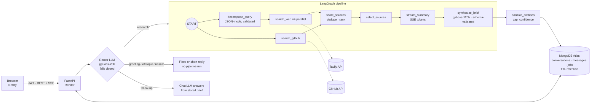

<div align="center">

# 🧠 ResearchMind AI

### An evaluated, production-style **R&D research agent** — ask a technology question, get a cited, comparison-driven decision brief in ~13 seconds.

[](https://researchmind-ai.netlify.app)
[](.github/workflows/ci.yml)


**[🚀 Live Demo](https://researchmind-ai.netlify.app)** · **[📊 Evaluation](#-evaluation-results)** · **[🏛️ Architecture](#️-architecture)** · **[⚡ Performance](#-performance-37s--134s)** · **[🔌 API](#-api-reference)**

</div>

---

## TL;DR

ResearchMind AI turns *"Which vector database should we use for 1M documents with hybrid search?"* into a **structured, source-cited R&D brief** — options, strengths/weaknesses, a criteria-by-criteria comparison, risks, a recommendation with a **confidence level**, and a **proof-of-concept plan**.

It is built the way a production LLM service should be: **measured** (offline eval harness with an LLM groundedness judge), **fast** (parallel retrieval, streamed output), **safe** (intent router, prompt-injection defence, fail-closed), **resilient** (retries, rate-limit back-off, SSE resume, crash recovery) and **tested** (139 tests, CI on every push).

| | |
|---|---|
| **p50 / p95 latency** | **13.4 s / 21.9 s** (24-topic eval), down from ~37 s |
| **Success rate** | **24 / 24 (100 %)**, 0 failures |
| **Citation coverage** | **94.9 %** of options & comparison rows carry a valid source |
| **Groundedness** (LLM-judge) | **77.7 %** claim-level, tracked per run |
| **Schema-valid briefs** | **100 %** (structure, planner and topic-coverage checks) |
| **Cost per brief** | **~6.4 k tokens** (≈2.6 k in / 3.8 k out) |

---

## 🎬 What it does

```
User: "Compare LangGraph, CrewAI and AutoGen for production multi-agent systems"

  router            → intent=research                         (guardrail + context resolution)
  decompose_query   → 4 focused sub-questions                 ~2.2 s
  search_web  ┐
  search_github ┘   → parallel retrieval, dedupe + rank       ~2.1 s  (GitHub runs alongside the planner)
  stream_summary    → executive summary streams to the UI     ~1.8 s
  synthesize_brief  → validated, cited JSON brief             ~9.0 s
                                                      total   ≈ 13.7 s   →  Recommendation: LangGraph (high confidence, groundedness 0.98)
```

**Output contract (`RDBrief`, Pydantic-validated):** title · problem statement · executive summary · landscape · 2–4 options (maturity, strengths, weaknesses, `source_ids`) · comparison matrix · risks (severity + mitigation) · recommendation (choice, rationale, **confidence**, next steps) · PoC plan · limitations.

---

## ✨ Highlights (what makes this more than a demo)

- **Evaluation-driven development.** A reproducible harness runs 24 golden topics across 12 categories and scores success, structure, planner health, citation coverage, topic coverage, **claim-level groundedness**, latency (p50/p95), token cost and per-node timings — then **diffs against a saved baseline** and flags regressions (metric drop > 0.05 or p95 latency > 1.3×).
- **~2.8× faster end-to-end, ~16× faster retrieval.** Replaced stdio MCP subprocesses with pooled async HTTP clients, parallelised the graph and streamed the summary so users see output while the brief is still generating.
- **Evidence-capped confidence.** The model can't claim *high* confidence on thin evidence: a deterministic post-check caps confidence to **medium** when the recommendation rests on <2 independent domains, and **low** when it has no supporting source — and records why in `limitations`.
- **Hallucinated citations are impossible by construction.** Every `source_ids` list is sanitised against the real source count before the response leaves the server.
- **Defence-in-depth against prompt injection.** A small, tool-less router model classifies every message (`greeting | research | follow_up | off_topic | unsafe | unclear`) *before* any work runs, user text is delimiter-wrapped and stripped of delimiter tags, and the router **fails closed**.
- **Real async job system.** Background jobs with SSE streaming, `Last-Event-ID` resume, cancellation, per-user ownership, TTL purge, a global concurrency cap with `429` back-pressure, and **MongoDB-backed crash recovery** for jobs interrupted by a restart.
- **Production-grade auth.** Argon2 password hashing (off the event loop), short-lived JWT access tokens, **rotating refresh tokens stored as SHA-256 digests**, refresh-token **reuse detection that revokes all sessions**, login lockout, and timing-equalised login to avoid user enumeration.
- **Observable by default.** Request-ID middleware (`X-Request-ID`), structured key=value logs per node (`pipeline.node_done node=… duration=…`), liveness + readiness probes.

---

## 📊 Evaluation results

Reproducible with one command (see [Running the evaluation](#-running-the-evaluation)). Latest full run: **24 golden topics** (databases, AI/LLM-ops, backend, infra, data, security, MLOps, frontend, niche), writer `gpt-oss-120b`, router/chat/judge `gpt-oss-20b`, streaming on.

| Metric | Result | What it measures |
|---|---:|---|
| Success rate | **100 %** (24/24) | Pipeline returned a valid brief — no failures, no retries exhausted |
| Structure OK | **100 %** | ≥2 options, ≥2 comparison rows, recommendation, exec summary, PoC plan |
| Planner OK | **100 %** | Planner returned usable sub-questions (no fallback to raw query) |
| Topic coverage | **100 %** | Brief mentions at least one expected candidate per topic |
| Citation coverage | **94.9 %** | Options/comparison rows backed by ≥1 *valid* source number |
| Groundedness | **77.7 %** | Per-claim LLM-as-judge: supported = 1, partial = 0.5, unsupported = 0 (≤24 claims per brief) |
| Confidence mix | 16 high · 8 medium · 0 low | After the evidence-cap post-check |
| Sources / domains | 4.1 / 3.9 per brief | Source diversity actually reaching the writer |
| Latency p50 / p95 | **13.4 s / 21.9 s** | End-to-end wall clock |
| Tokens / brief | 6,359 (2,574 in · 3,786 out) | Direct cost driver |

### Iteration history (how the numbers moved)

| Run (UTC) | Topics | p50 | p95 | Citation cov. | Groundedness | Note |
|---|---:|---:|---:|---:|---:|---|
| 2026‑11‑12 | 3 | 17.1 s | 17.5 s | 0.93 | n/a | First harness run, no judge yet |
| 2026‑11‑17 | 3 | 14.4 s | 16.2 s | 1.00 | 0.76 | LLM judge added |
| 2026‑11‑18 | 3 | 14.9 s | 15.0 s | 0.98 | 0.93 | Prompt/grounding tuning |
| **2026‑11‑19** | **24** | **13.4 s** | **21.9 s** | **0.95** | **0.78** | **Full golden set → current baseline** |

> **Engineering note:** the 3-topic run looked great (0.93 groundedness) but did **not** generalise to the full 24-topic set (0.78). That is exactly why the harness exists — small samples flatter you. The 24-topic run is the baseline CI regressions are measured against.

### Where the groundedness gaps are (honest error analysis)

The judge's `unsupported_examples` show a consistent pattern: most misses are **plausible background claims about cost/licensing/maturity that the retrieved snippets don't state** (e.g. *"Apache-2.0 licensed"*, *"vendor lock-in"*). The writer is instructed to use only sources and to put gaps in `limitations`; tightening this (claim-level source attribution, snippet-length vs. recall trade-off) is the main roadmap item.

---

## ⚡ Performance: 37 s → 13.4 s

| Stage | Before (MCP, sequential) | After (direct async, parallel) | Δ |
|---|---:|---:|---:|
| Planning | 1.4 s | 2.2 s (`gpt-oss`, JSON-mode, validated) | slightly slower, more reliable |
| Retrieval (web + GitHub) | **~34 s** | **~2.1 s** web · 0.8 s GitHub *(parallel with planner)* | **≈ 16× faster** |
| Writing | 1.8 s (2.1 k-char markdown) | 1.8 s streamed summary + 9.0 s full structured brief | richer output, streamed |
| **End-to-end** | **~37 s** | **13.4 s p50 · 21.9 s p95** | **−64 % (≈ 2.8×)** |

*Before = first version's demo run (3 separate graphs, `langchain-mcp-adapters` spawning `npx` stdio servers per call, `llama-3.3-70b`). After = measured over the 24-topic eval. The "after" output is also substantially richer (structured comparison, risks, PoC plan, confidence), so the speedup is not bought by doing less.*

**What changed and why it worked**

| Change | Effect |
|---|---|
| Dropped stdio MCP subprocesses → **direct Tavily + GitHub REST** over one shared `httpx.AsyncClient` (keep-alive pool, 5 s connect / 20 s read timeouts) | Removed per-call process spawn + handshake — the dominant cost (~34 s → ~2 s) |
| **One graph, real parallelism**: planner ‖ GitHub search; sub-question web searches via `asyncio.gather` | Retrieval overlaps planning; N sub-questions cost ≈ 1 search |
| **Streamed executive summary** (`stream_summary` node, coalesced SSE chunks) | User sees text after ~5–6 s instead of waiting ~13 s (perceived latency) |
| Right-sized models: `gpt-oss-120b` only for the brief; `gpt-oss-20b` for routing, chat, summary, judge | Cheap/fast calls where quality isn't the bottleneck |
| Singleton, cached LLM clients created at startup (`lru_cache`) | No per-request client/connection setup |
| Bounded concurrency (semaphores for pipelines / searches / LLM calls) | Stable latency under load instead of provider 429 storms |

> **Outlier transparency:** the slowest topic (`llm-serving`, 40 s) was a 12 k-token brief where `synthesize_brief` alone took 34 s — it is what pulls p95 up to 21.9 s. Output-length control is on the roadmap.

---

## 🏛️ Architecture



### Request lifecycle

1. `POST /api/research/jobs` → **202** immediately with `job_id` + stream URL (the request never blocks on the LLM).
2. The **router** classifies the message with conversation context and rewrites follow-ups into a self-contained `standalone_query`.
3. The **pipeline** runs under a global semaphore; every node is wrapped by `track_progress` which emits `node_started` / `node_completed` events with timings.
4. The client consumes **SSE** (`/stream`), can reconnect with `Last-Event-ID` to replay missed events, and can cancel via `DELETE`.
5. Outcome is persisted to MongoDB; on restart, `recover_interrupted_jobs` marks orphaned jobs so clients never wait on a ghost.

### Key design decisions (and trade-offs)

| Decision | Why | Trade-off accepted |
|---|---|---|
| **Direct REST instead of MCP at runtime** | MCP stdio servers cost a process spawn + handshake per call; for a latency-sensitive path, pooled HTTP is ~16× faster and easier to retry/time-box | Gave up swap-any-server flexibility; kept the retrieval layer isolated in `core/search_api.py` so it remains replaceable |
| **JSON-mode + Pydantic instead of tool-calling** for planner/writer | Tool-calling failed intermittently (model answered in prose → silent 1-search degradation). JSON-mode + schema validation + bounded retries is deterministic | Needs tolerant validators (`BeforeValidator` coercion for string-vs-list, enum casing) |
| **Router fails closed** | If classification can't be obtained, reject — never run the expensive/untrusted path unchecked | Occasional `503`/`429` under provider outages instead of degraded answers |
| **Deterministic post-checks over prompt-only rules** | `sanitize_citations` and `cap_confidence` enforce invariants the model can't be trusted to follow | Extra code, but testable (unit tests assert each cap path) |
| **GitHub signal = stars (√-scaled), licence, last push** | Gives the writer maturity/health evidence, not just text | Star count is a popularity proxy, not quality |
| **Stateless JWT access + stateful rotating refresh** | Cheap per-request auth, revocable sessions | Refresh needs DB; reuse detection revokes the whole session family |
| **Single active-job lock per conversation** | Prevents interleaved writes and duplicate pipelines | Users wait for the current answer before sending the next |

---

## 🛡️ Reliability, safety & security

| Area | Implementation |
|---|---|
| **Retries & back-off** | `tenacity` exponential back-off + jitter on 429/5xx/transport errors only (never on 4xx); LLM 429s are waited out using the provider's `Retry-After` / "try again in Xs" hint, capped at 6 s |
| **Timeouts** | Per-call (HTTP 20 s, router 15 s, chat 45 s, LLM 90 s) and per-pipeline (180 s) |
| **Back-pressure** | Semaphores: 3 pipelines · 8 searches · 4 LLM calls; `429 server_busy` when >20 jobs are pending |
| **Graceful degradation** | One failed sub-question search doesn't fail the node; failed summary stream doesn't break the brief; planner falls back to the raw query |
| **Streaming correctness** | Never retries after the first token was shown; reuses the streamed summary verbatim in the final brief so the UI doesn't "change its mind" |
| **Prompt-injection defence** | Router has no tools; user/context wrapped in delimiters with delimiter tags stripped; retrieved snippets & briefs treated as *data, never instructions*; refusal text is fixed and model replies containing URLs/code/tags are rejected |
| **Auth** | Argon2id hashing in `asyncio.to_thread`; JWT `HS256` with required `exp/sub/iat`, token-type check; min 32-char secret enforced at startup; login lockout (5 attempts → 15 min); timing-equalising dummy hash |
| **Data hygiene** | Per-user job/conversation ownership checks; MongoDB TTL indexes (30-day retention); unique `(job_id, role)` index makes writes idempotent |
| **Errors** | Uniform `ErrorResponse` envelope; unexpected exceptions never leak internals (tested) |
| **Ops** | `/api/health` (liveness) · `/api/health/ready` (queue/job counts, no external calls) · `X-Request-ID` echoed on every response · OpenAPI docs disabled in production |

---

## 🛠️ Tech stack

| Layer | Technology |
|---|---|
| **Orchestration** | LangGraph 0.2 (single compiled `StateGraph`, parallel fan-out/fan-in) |
| **LLMs** | Groq-hosted `openai/gpt-oss-120b` (writer) · `openai/gpt-oss-20b` (router, chat, summary, judge) via `langchain-groq` |
| **Retrieval** | Tavily Search API + GitHub Search API (async `httpx`, `tenacity`) |
| **API** | FastAPI · Pydantic v2 / pydantic-settings · SSE streaming · uvicorn |
| **Persistence** | MongoDB Atlas (`pymongo`) — conversations, messages, jobs, users, sessions; TTL indexes |
| **Auth** | `argon2-cffi`, `PyJWT` |
| **Frontend** | Vanilla HTML/CSS/JS (single file, no build step) — live progress timeline, streamed summary, conversation history, JWT refresh |
| **Quality** | `pytest` + `pytest-asyncio` (139 tests) · custom eval harness · GitHub Actions CI (with Mongo service) |
| **Deploy** | Render (backend, Blueprint `render.yaml`) · Netlify (frontend) · MongoDB Atlas |

---

## 📁 Project structure

```
ResearchMind-AI/
├── backend/
│   ├── app/
│   │   ├── main.py                    # app factory, lifespan (startup/shutdown order), request-id middleware
│   │   ├── core/
│   │   │   ├── config.py              # typed settings (limits, timeouts, models, auth)
│   │   │   ├── llm.py                 # cached Groq clients + rate-limit delay parsing
│   │   │   ├── search_api.py          # Tavily/GitHub clients with retry/back-off
│   │   │   ├── runtime.py             # shared httpx pool, semaphores, DI helpers
│   │   │   ├── security.py            # Argon2, JWT, refresh-token hashing
│   │   │   ├── mongo.py               # connection + index/TTL setup
│   │   │   ├── prompts.py             # planner / writer / router / follow-up prompts
│   │   │   └── errors.py, logger.py
│   │   ├── controllers/
│   │   │   ├── router_controller.py   # intent routing + guardrails (fails closed)
│   │   │   ├── planner_controller.py  # query decomposition
│   │   │   ├── search_controller.py   # web/GitHub search, scoring, dedupe
│   │   │   ├── writer_controller.py   # summary stream, brief synthesis, citation + confidence checks
│   │   │   ├── pipeline_controller.py # LangGraph assembly + progress events
│   │   │   ├── job_controller.py      # async jobs, SSE, cancel, TTL purge
│   │   │   ├── memory_controller.py   # conversations, context building, crash recovery
│   │   │   ├── chat_controller.py     # follow-up answers + token streaming
│   │   │   └── auth_controller.py     # register/login/refresh/logout
│   │   ├── routers/                   # auth · research · conversations · health
│   │   └── schemas/                   # Pydantic contracts (RDBrief, jobs, chat, memory…)
│   ├── evals/
│   │   ├── golden_topics.json         # 24 topics · 12 categories · expected candidates
│   │   ├── research_eval.py           # eval runner (LLM judge, baseline diff)
│   │   ├── metrics.py                 # citation / groundedness / latency / regression logic
│   │   └── baseline.json              # current regression baseline
│   ├── tests/                         # 139 tests: pipeline, jobs, router, auth, memory, metrics
│   ├── requirements.txt · requirements-dev.txt · run.py
├── frontend/index.html                # SPA: auth, history, live timeline, streamed output
├── .github/workflows/ci.yml           # tests on push/PR; optional on-demand eval job
└── render.yaml                        # Render Blueprint (IaC)
```

---

## 🚀 Quick start

**Prerequisites:** Python 3.11+, free API keys from [Groq](https://console.groq.com), [Tavily](https://app.tavily.com), a [GitHub token](https://github.com/settings/tokens), and a MongoDB (local or [Atlas free tier](https://www.mongodb.com/atlas)).

```bash
git clone https://github.com/patelyogi2635-gif/ResearchMind-AI.git
cd ResearchMind-AI/backend

python -m venv .venv
source .venv/bin/activate            # Windows: .venv\Scripts\activate
pip install -r requirements-dev.txt

cp .env.example .env                 # then fill in the values below
```

```env
GROQ_API_KEY=gsk_...
TAVILY_API_KEY=tvly-...
GITHUB_TOKEN=ghp_...
JWT_SECRET=<at least 32 random characters>      # python -c "import secrets; print(secrets.token_urlsafe(48))"
MONGODB_URI=mongodb://localhost:27017           # or your Atlas URI
MONGODB_ENABLED=true
# optional: LLM_MODEL, ROUTER_MODEL, CHAT_MODEL, STREAMING_ENABLED, CORS_ORIGINS, ...
```

```bash
python run.py                        # or: uvicorn app.main:app --reload --port 8000
# open frontend/index.html (set the API base to http://localhost:8000) or use the live site
```

> The hosted backend runs on Render's free tier, so the **first request after idle can take a few extra seconds to wake the service**.

---

## 🧪 Testing & CI

```bash
cd backend
python -m pytest -q          # 139 tests, no API keys or network required
```

The suite uses monkeypatched LLM/search layers, so it is fast and deterministic. It covers:

- **Pipeline & search:** parallel sub-question search, partial failure tolerance, URL dedupe/ranking, GitHub query building and health signals
- **Writer integrity:** citation sanitising, confidence capping (single domain → medium, none → low), tolerant schema coercion, retry + rate-limit paths
- **Jobs & streaming:** event ordering, `Last-Event-ID` resume, cancellation, bounded concurrency, back-pressure, TTL purge
- **Router & safety:** fail-closed behaviour, prompt-delimiter escape attempts, fixed refusals, follow-up downgrade without a brief
- **Auth & tenancy:** token validation/expiry, lockout, refresh rotation, per-user job isolation
- **Eval metrics:** citation/groundedness/percentile/regression maths

GitHub Actions runs the suite on every push/PR (with a Mongo service container) and offers a **manual `workflow_dispatch` eval job** that uploads the JSON report as an artifact.

---

## 📈 Running the evaluation

```bash
cd backend
python -m evals.research_eval --limit 3                       # quick smoke (3 topics)
python -m evals.research_eval                                  # all 24 golden topics + LLM judge
python -m evals.research_eval --ids vector-db agent-frameworks # specific topics
python -m evals.research_eval --no-judge                       # skip groundedness judge (cheaper)
python -m evals.research_eval --set-baseline                   # save this run as the new baseline
```

Each run writes a timestamped JSON report (per-topic latency, per-node seconds, tokens, citation stats, unsupported-claim examples) and prints a regression diff versus `evals/baseline.json`.

**Metric definitions**

- **Citation coverage** = options + comparison rows with ≥1 valid `source_id` ÷ total rows.
- **Groundedness** = mean per-claim verdict from an LLM judge reading *only* the retrieved sources (supported 1 · partial 0.5 · unsupported 0).
- **Regression gate** = any higher-is-better metric dropping by >0.05, or p95 latency rising >30 %.

---

## 🔌 API reference

All endpoints except health and auth are **Bearer-JWT protected**. Errors use a uniform envelope `{ "detail": "...", "error": { "code", "message", "request_id" } }`, so any failure can be traced through the logs by `request_id`.

| Method | Endpoint | Purpose |
|---|---|---|
| `POST` | `/api/auth/register` · `/login` · `/refresh` · `/logout` | Account + rotating-refresh session management |
| `GET` | `/api/auth/me` | Current user |
| `POST` | `/api/research/jobs` | Start a message as a background job (**202**), optionally inside a conversation |
| `GET` | `/api/research/jobs/{id}` | Poll status/result |
| `GET` | `/api/research/jobs/{id}/stream` | **SSE** progress + tokens; resumable via `Last-Event-ID` |
| `DELETE` | `/api/research/jobs/{id}` | Cancel a queued/running job |
| `POST` | `/api/research` | Blocking, stateless variant (same queue & limits) |
| `GET/DELETE` | `/api/conversations[/{id}]` | History with cursor pagination · delete (cancels running jobs) |
| `GET` | `/api/lookup/{id}` | Resolve a conversation from a job/message/request id (support/debugging) |
| `GET` | `/api/health` · `/api/health/ready` | Liveness · readiness (queue depth, no external calls) |

**Example — start a job and stream it**

```bash
curl -X POST "$API/api/research/jobs" \
  -H "Authorization: Bearer $TOKEN" -H "Content-Type: application/json" \
  -d '{"query": "Which vector database should we use for 1M documents with hybrid search?"}'
# → 202 { "job_id": "...", "status": "queued", "status_url": "...", "stream_url": "...", "conversation_id": "..." }

curl -N "$API/api/research/jobs/$JOB_ID/stream" -H "Authorization: Bearer $TOKEN"
# event: job_started    data: {"job_id":"...","query":"..."}
# event: routed         data: {"intent":"research"}
# event: node_started   data: {"node":"decompose_query"}
# event: node_completed data: {"node":"search_web","duration_seconds":2.1,"results_count":14}
# event: token          data: {"text":"...","target":"summary"}   # streamed executive summary
# event: job_completed  data: {"job_id":"...","result":{ "brief":{...},"report":"...","sources":[...] }}
```

---

## 🌐 Deployment

| Component | Platform | Notes |
|---|---|---|
| Backend | **Render** (Blueprint) | `render.yaml`: `rootDir: backend`, health check `/api/health`, auto-deploy, generated `JWT_SECRET`, secrets marked `sync: false` |
| Frontend | **Netlify** | Static single file; API base resolved at runtime |
| Database | **MongoDB Atlas** | TTL indexes handle retention; `MONGODB_REQUIRED=true` fails fast if unreachable |

Deploy your own: fork → Render **New → Blueprint** → set `GROQ_API_KEY`, `TAVILY_API_KEY`, `GITHUB_TOKEN`, `MONGODB_URI`, `CORS_ORIGINS` → deploy the `frontend/` folder to Netlify with the backend URL.

---

## ⚠️ Known limitations (and what I'd do next)

I'd rather state these than have them found in review:

- **Groundedness is 77.7 %, not 95 %.** Remaining misses are mostly unstated background claims on cost/licensing. *Next:* claim-level attribution, quote-grounded generation, and a stricter "insufficient evidence" path.
- **LLM-as-judge shares a model family with the generator** (`gpt-oss`). It's a useful regression signal, not ground truth. *Next:* human-labelled subset + a cross-family judge to estimate judge bias.
- **Retrieval uses short snippets (≤700 chars) and Tavily "basic" depth.** Fast, but caps evidence quality. *Next:* selective full-page fetch + reranking for the top sources.
- **Eval set is 24 topics, one run each.** No confidence intervals yet. *Next:* repeat runs and report variance.
- **Latency tail** is driven by very long briefs (max 40 s). *Next:* output-length budget per topic complexity.
- **In-memory job registry** is per-process (MongoDB provides durability/recovery, not horizontal scaling). *Next:* Redis-backed queue for multi-instance.

---

## 🗺️ Roadmap

- [x] Multi-graph prototype with MCP (Tavily + GitHub)
- [x] Direct async retrieval, single parallel graph, **~2.8× faster**
- [x] Structured `RDBrief` + deterministic citation & confidence guards
- [x] Intent router, prompt-injection defence, follow-up Q&A over stored briefs
- [x] SSE streaming with resume, cancellation, crash recovery
- [x] JWT auth with rotating refresh tokens + reuse detection
- [x] Eval harness (24 topics, LLM judge, regression gate) + CI
- [ ] Reranking + selective full-page fetch to lift groundedness
- [ ] Cross-family judge + human-labelled calibration set
- [ ] Redis queue for horizontal scaling
- [ ] Report export (PDF / Markdown) and shareable brief links
- [ ] Tracing (OpenTelemetry / Langfuse) for per-node token & latency dashboards

---

## 👤 Author

**Yogi Patel** — AI Engineer

[](https://github.com/patelyogi2635-gif)
[](https://linkedin.com/in/patel-yogi-0a2526346)
[](https://researchmind-ai.netlify.app)

<sub>Built with LangGraph · FastAPI · Groq · MongoDB · Python — measured, not just demoed.</sub>